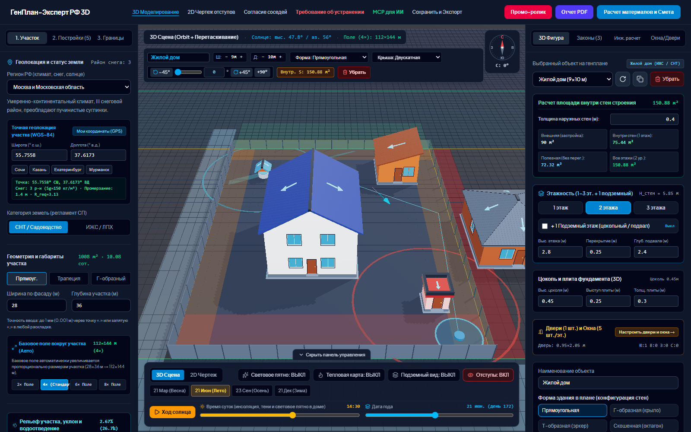
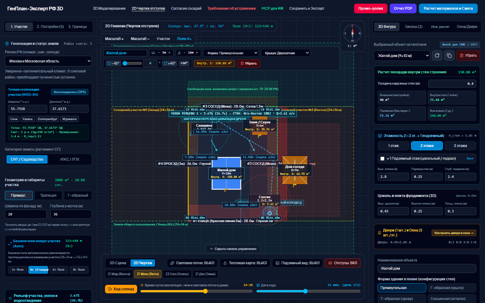
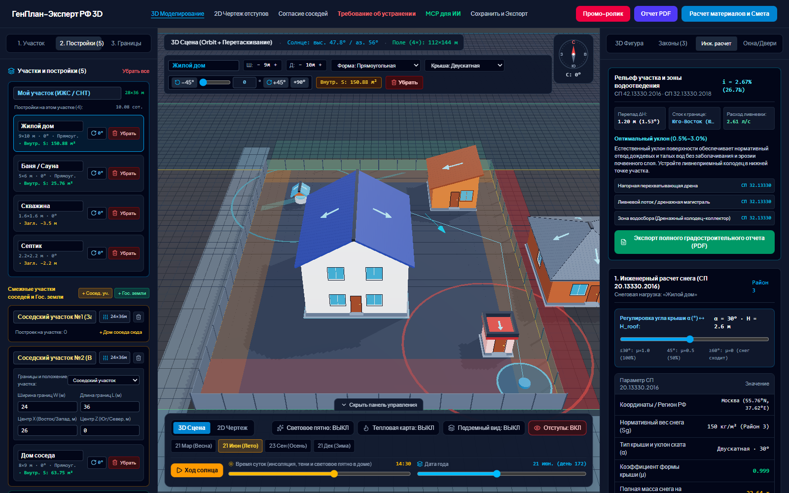
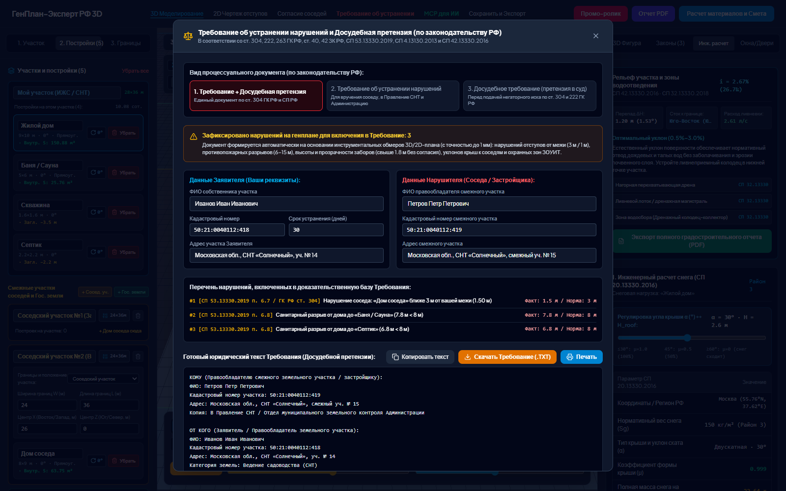
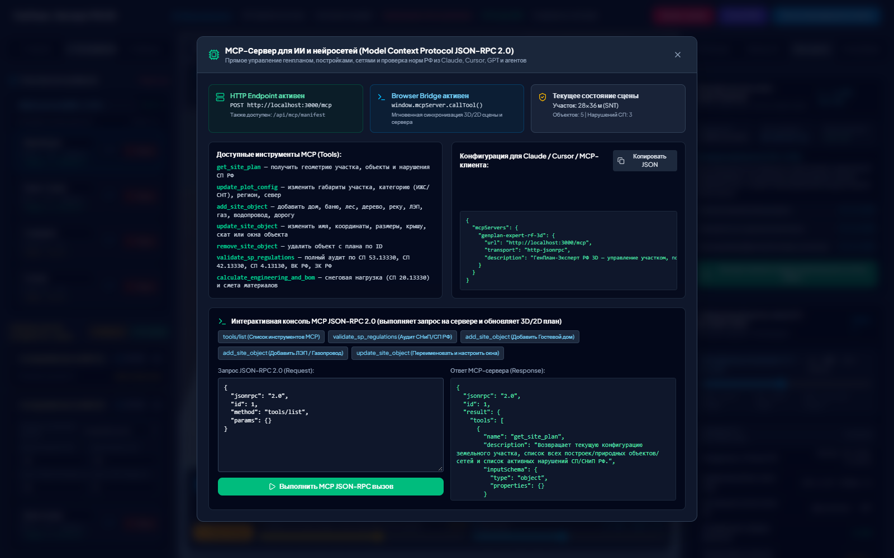
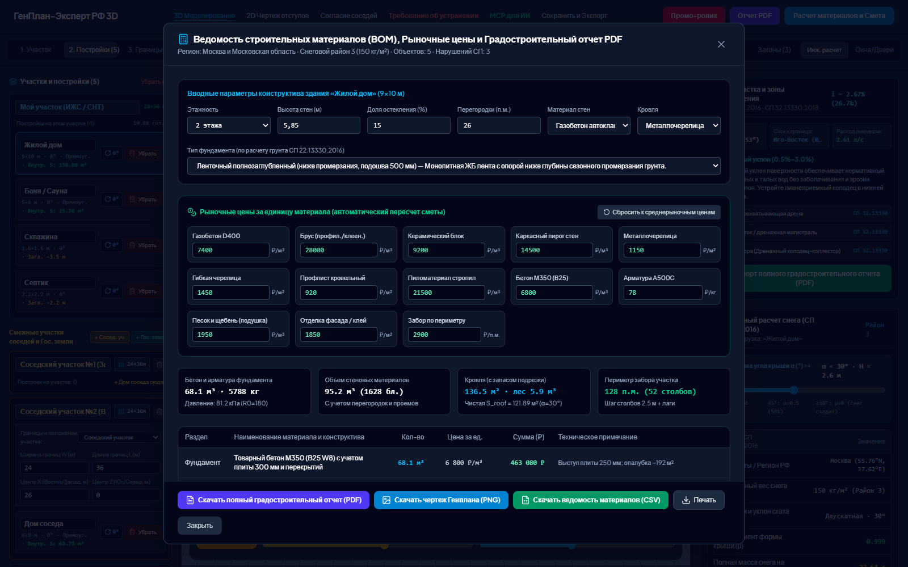
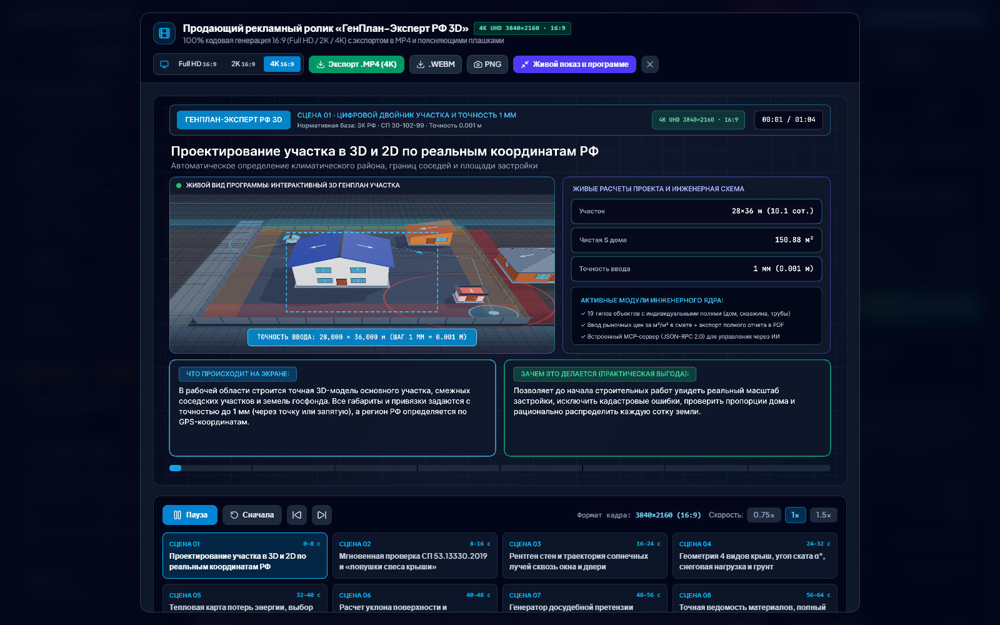

<div align="center">

# ГенПлан-Эксперт РФ 3D

**Практический 3D-планировщик участка для тех, кто планирует постройку дома или уже его построил.**

Расстановка построек, проверка отступов и пожарных разрывов по СП, инсоляция, снеговая нагрузка, фундамент, смета материалов и юридические документы — в одном приложении.

[-blue)](#лицензия)
[](https://nodejs.org)
[](https://react.dev)
[](https://threejs.org)

</div>



## Зачем это нужно

Планирование дома обычно начинается с вопроса «а поместится ли всё на участке и не нарушит ли это нормы». ГенПлан-Эксперт РФ 3D собирает в одном интерфейсе то, что обычно разбросано по калькуляторам, таблицам и документам:

- **3D-двойник участка** с домом, баней, гаражом, скважиной, септиком и соседними постройками.
- **Нормативная проверка** отступов, пожарных разрывов, инсоляции и зон ограничений.
- **Инженерные расчёты** снеговой нагрузки, фундамента, теплопотерь и энергоэффективности.
- **Смета материалов** с рыночными ценами и выгрузкой в PDF, PNG, CSV и JSON.
- **Юридические документы** — досудебное требование соседу и согласие на ограждение.
- **MCP-сервер** для ИИ-агентов, которым нужно управлять генпланом напрямую.

Проект написан на React 19 + TypeScript + Vite + three.js, серверная часть — Express. Всё работает локально, без внешних баз данных и платных API.

## Возможности

### Планирование участка

- Участок прямоугольной, трапециевидной или Г-образной формы; ширина, глубина и точность ввода до 1 мм.
- ВРИ участка (ИЖС / ЛПХ / СНТ), регион РФ с климатическими данными, GPS-координаты и ближайший климатический район.
- Рельеф по четырём углам, уклон, направление стока и зоны водоотведения.
- Базовое поле вокруг участка, привязка к соседним участкам и землям госфонда.
- **19 категорий объектов**: жилой дом, баня, гараж, сарай, теплица, птичник, туалет, скважина, септик, дом и колодец соседа, лес, деревья, водоём, ЛЭП, газ, водопровод, канализация, дорога.
- Поворот, размеры, форма в плане, этажность, цоколь, двери и окна.

### Нормы и расчёты

- **СП 53.13330.2019** — отступы до границ, санитарные разрывы, размещение построек.
- **СП 4.13130.2013** — противопожарные расстояния между зданиями.
- **СП 20.13330.2016** — снеговые районы, коэффициент μ для скатных крыш, масса снега.
- **СП 50.13330.2012** — теплопотери через стены, окна, крышу и пол, энергокласс.
- **СП 42.13330.2016** и **СП 22.13330** — планировка, фундаменты, грунты.
- **СанПиН 1.2.3685-21** — инсоляция и световое пятно в помещении.
- **ВК РФ, ЗК РФ, ГрК РФ** — основания для требований и согласований.

### Документы и выгрузки

- Полный градостроительный отчёт **PDF** с текущим снимком сцены.
- Чертёж генплана **PNG**, ведомость материалов **CSV**, проект **JSON**.
- **Требование об устранении нарушений** и досудебная претензия с подстановкой реквизитов.
- **Согласие собственника соседнего участка** на ограждение и отступы.
- Промо-студия: ролик 16:9 в **Full HD / 2K / 4K**, экспорт `MP4`, `WebM` и PNG-кадра.

### MCP для ИИ

Встроенный MCP-сервер отдаёт генплан, постройки и нарушения через JSON-RPC 2.0. Семь инструментов: `get_site_plan`, `update_plot_config`, `add_site_object`, `update_site_object`, `remove_site_object`, `validate_sp_regulations`, `calculate_engineering_and_bom`.

## Скриншоты

| 2D-чертёж с отступами | Инженерный расчёт |
|---|---|
|  |  |

| Юридическое требование | MCP-сервер |
|---|---|
|  |  |

| Смета материалов | Промо-студия |
|---|---|
|  |  |

## Быстрый старт

**Требования:** Node.js 20.19+ (или 22.12+) и npm.

```bash
npm install
npm run dev
```

Приложение откроется на `http://localhost:3000`.

Сборка и запуск в production-режиме (Express отдаёт собранный `dist` и API):

```bash
npm run build
npm start
```

Другие команды:

```bash
npm test      # 32 юнит-теста расчётов (node:test через tsx)
npm run lint  # проверка типов TypeScript
npm run clean # удалить dist
```

> `npm run preview` запускает только статический Vite-превью без API/MCP. Для полной проверки используйте `npm run build && npm start`.

## MCP-сервер

Сервер поднимается вместе с приложением на том же порту.

| Метод | Путь | Назначение |
|---|---|---|
| `GET` | `/api/mcp/manifest` | Описание сервера и список инструментов |
| `GET` / `POST` | `/api/mcp/state` | Чтение и замена состояния генплана |
| `POST` | `/mcp` | JSON-RPC 2.0: `initialize`, `tools/list`, `tools/call` |
| `POST` | `/api/mcp/rpc` | То же, что `/mcp` |

Пример вызова:

```bash
curl -s http://localhost:3000/mcp \
  -H "Content-Type: application/json" \
  -d '{"jsonrpc":"2.0","id":1,"method":"tools/call","params":{"name":"validate_sp_regulations","arguments":{}}}'
```

Ответ содержит стандартный `result.content[0].text` с JSON-строкой, а также `result.data` и `result.state` для удобной синхронизации клиента. В браузере доступен мост `window.mcpServer.callTool(name, args)`; он обновляет те же React-состояния, что и интерфейс.

Сервер реализует простой JSON-RPC 2.0 поверх HTTP POST. Он подходит для собственных агентов, скриптов и клиентов, умеющих вызывать HTTP JSON-RPC напрямую.

## Как это устроено

```
server.ts                 Express: API, MCP, Vite middleware / static dist
src/App.tsx               Состояние проекта, сценарии, модальные окна
src/components/           3D/2D-вьюпорт, боковые панели, отчёты, промо-студия
src/utils/calculations.ts Нормативные расчёты, снег, фундамент, смета
src/utils/roofGeometry3D.ts Геометрия крыш и световых пятен
src/utils/pdfReportGenerator.ts  PDF без внешних библиотек
src/types/                Типы участка, объектов и нарушений
```

- Состояние хранится в `localStorage` (`genplan_expert_rf_v2`) и синхронизируется с сервером через `POST /api/mcp/state`.
- 3D-сцена строится на three.js с on-demand-рендером; 2D-план — на Canvas.
- Отчёты и промо-ролик генерируются полностью на клиенте.
- Сервер не хранит данные на диске: состояние живёт в памяти процесса и сбрасывается при перезапуске.

## Тестирование

- **32 юнит-теста** в `src/utils/calculations.test.ts`: формы крыш, снег, пожарные разрывы, фундаменты, инсоляция, теплопотери, смета, PDF и промо-сценарий. Запуск: `npm test`.
- **14 E2E-сценариев** Playwright (Chromium, headless + SwiftShader) покрывают загрузку без JS-ошибок, конфигурацию участка, все 19 категорий объектов, инспектор, юридические документы, смету и выгрузки, PDF, промо-студию, MCP-модалку, HTTP API, автосохранение, 2D-вид и таймлайн солнца.
- На момент публикации: `32/32` unit, `14/14` E2E, `tsc --noEmit` без ошибок, production-сборка успешна.

E2E-набор запускается локально и не входит в репозиторий (не загрязняет проект тестовой обвязкой).

## Ограничения

- Интерфейс спроектирован для десктопа; на экранах уже ~1280 px боковые панели вытесняют 3D-вьюпорт.
- Состояние на сервере не persists между перезапусками; для сохранения используйте JSON-экспорт.
- Нет аутентификации и CORS: сервер рассчитан на локальный запуск, не выставляйте его в открытую сеть.
- Расчёты и документы носят справочный характер и **не заменяют** проектную документацию, изыскания и заключения уполномоченных органов.

## Лицензия

Проект распространяется по **Source-Available License v1.0** (не OSI open source):

- ✅ просмотр исходного кода и ознакомление;
- ✅ установка и личное некоммерческое использование, включая планирование собственного дома;
- ❌ копирование, публикация, распространение и передача третьим лицам;
- ❌ изменение, форк и создание производных произведений;
- ❌ коммерческое использование.

Полный текст — в файле [LICENSE](LICENSE). Для разрешений за пределами лицензии: [github.com/Prophetic-Helgy](https://github.com/Prophetic-Helgy).

## Благодарности

Проект использует React, three.js, Vite, Tailwind CSS, Express, SunCalc и Lucide. Спасибо их авторам за открытые лицензии. Нормативная база приведена по действующим СП, СанПиН и кодексам РФ; перед применением в реальном проекте проверяйте актуальные редакции документов.
